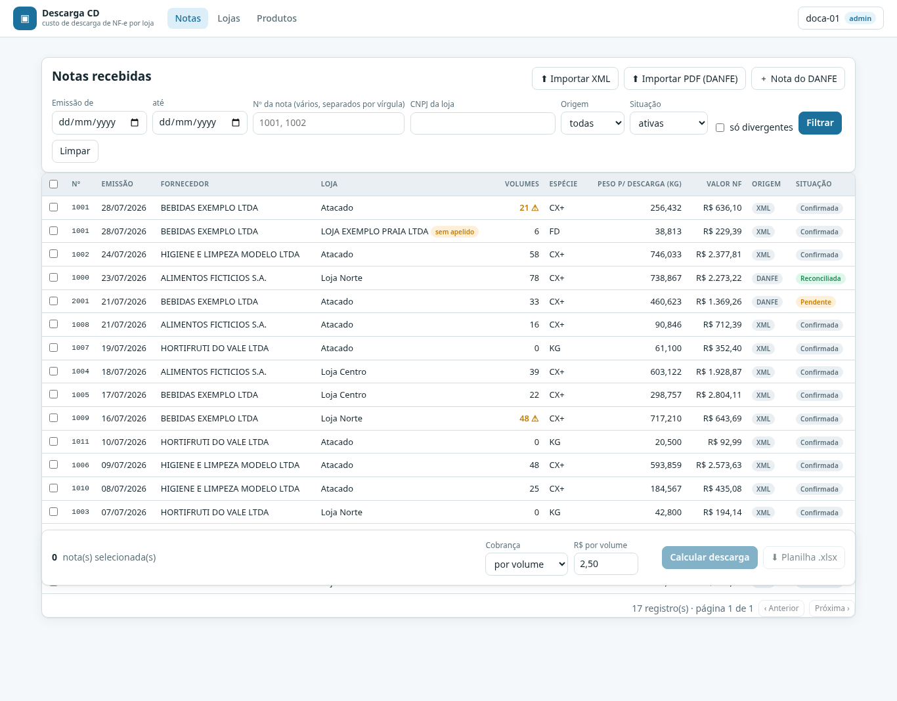
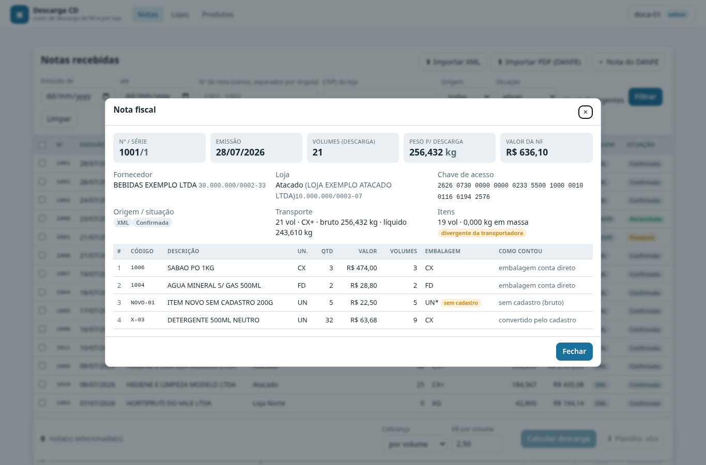
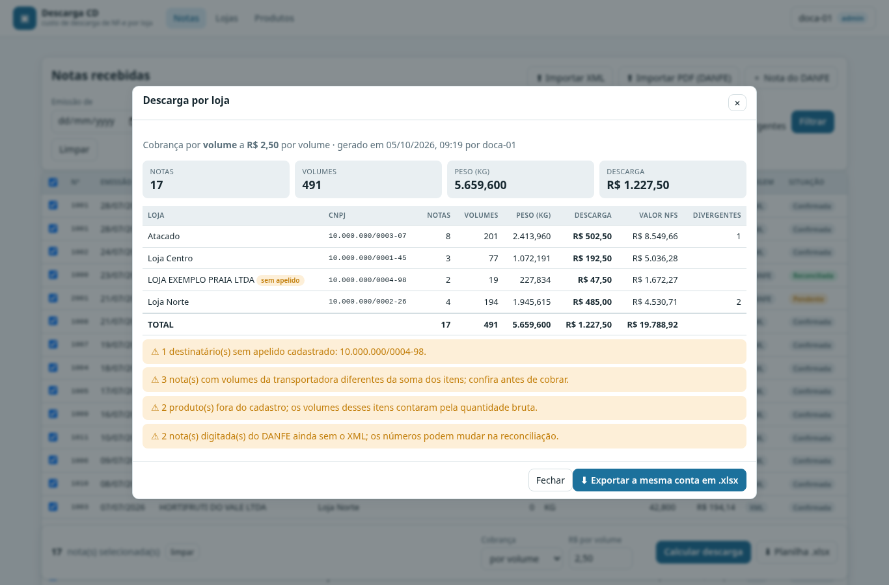

<p align="center"></p>

# Custo de descarga de NF-e no centro de distribuição

Sistema (API NestJS + front Angular) que calcula quanto o centro de
distribuição paga pela descarga de cada carga recebida, rateado por loja
destinatária, a partir dos XMLs de NF-e, dos DANFEs em PDF e do cadastro de
embalagens de compra. Reprodução, com dados sintéticos, da arquitetura de um
sistema que opera em uma rede varejista; nenhum dado real está neste
repositório.



```
Se o contrato é por volume → descarga = total de volumes × R$ por volume
Se o contrato é por peso   → descarga = total de kg      × R$ por kg
```

Um método por vez, nunca os dois somados. O difícil não é a conta: é saber
quantos volumes físicos uma nota representa quando o fornecedor vende em UN,
KG, CX ou FD e cada um descreve o mesmo produto do seu jeito.

## O problema

A doca recebe por dia dezenas de notas de dezenas de fornecedores. A
transportadora cobra a descarga por volume (caixa, fardo, saco) ou por peso. A
nota fiscal, porém, traz quantidade comercial na unidade que o fornecedor
escolheu:

- `48 UN` de biscoito podem ser 2 caixas de 24, ou 48 unidades soltas, ou 1
  caixa e 24 soltas;
- `30 KG` de tomate não são volumes, são peso;
- `qVol` do transporte (o que a transportadora declarou) nem sempre bate com a
  soma dos itens;
- hortifrúti costuma vir sem `pesoB`, e aí o peso cobrado tem que sair dos
  itens em KG;
- o mesmo produto chega como `BISCOITO RECHEADO CHOCOLATE 140G` de um
  fornecedor e `BISCOITO 140G RECHEADO - CHOCOLATE` de outro, às vezes sem EAN.

Antes, isso era conferido à mão em planilha, com dois caminhos de cálculo (tela
e exportação) que podiam divergir sem ninguém notar.

## A solução

1. **Parser de XML da NF-e** tolerante ao mundo real: encoding declarado
   (ISO-8859-1 é comum), tags com e sem prefixo de namespace, chave de acesso
   do protocolo ou do `Id`, `dEmi` como fallback de `dhEmi`, CPF no
   destinatário, vários `<vol>`.
2. **Regra de volumes por item** em três famílias de unidade: embalagem física
   conta direto; medida contínua não vira volume; unidade avulsa (UN) é
   convertida pela embalagem de compra do cadastro, contando cada unidade solta
   como um volume.
3. **Cascata de busca no cadastro**: EAN (com variantes GS1 e GTIN-14 de
   caixa) → código do fornecedor → nome exato → alias aprendido → nome
   normalizado por tokens, só quando aponta para um único produto. Um acerto
   por nome é gravado como alias e a próxima nota do mesmo fornecedor casa
   direto.
4. **Recálculo da nota**: volumes da transportadora prevalecem quando
   informados, a divergência com a soma dos itens é sinalizada (exceto quando
   há medida contínua, porque aí a soma não é comparável), e o peso cobrado é
   o bruto ou, na falta dele, a soma dos itens em massa.
5. **Fechamento por loja** com uma única fonte de números para o JSON e para a
   planilha, avisos do que compromete o valor (loja sem apelido, divergência,
   item sem cadastro, nota digitada ainda sem XML) e recusa do cálculo quando
   alguma nota da seleção não existe mais.
6. **Nota pendente da doca**: a chave de acesso lida do DANFE entra antes do
   XML; quando o XML chega, a nota é reconciliada pela chave, a observação do
   operador é preservada e a diferença entre o digitado e o real vira aviso.
7. **Leitura do DANFE em PDF** com precisão acima de cobertura: a âncora é a
   chave de acesso (DV conferido), o número e o CNPJ derivados dela têm que
   estar impressos, a data é a menor que casa com a competência da chave, e
   os itens só entram quando quantidade × unitário fecha com o total e a soma
   fecha com o total dos produtos. Página ambígua é rejeitada com motivo;
   cargas com vários DANFEs e notas em duas folhas são agrupadas pela chave.
8. **Planilha de produtos do ERP** (xlsx ou csv com `;`): cabeçalhos
   reconhecidos com tolerância aos nomes de cada ERP, upsert pela tripla
   código + embalagem + quantidade, relato linha a linha.
9. **Front Angular** para a doca: tabela de notas com filtros e seleção,
   fechamento por volume ou peso com exportação, upload de XML e PDF, nota do
   DANFE com decodificação da chave na hora, cadastro de lojas e produtos.



## Arquitetura

```
api/src/
├── domain/        regra de negócio pura, sem Nest nem banco
│   ├── units        famílias de unidade comercial (embalagem, contínua, massa)
│   ├── volumes      regra de volumes por item e escolha da master pack
│   ├── catalog      cascata de busca + aprendizado de alias (referência em memória)
│   ├── unloading    recálculo da nota, peso de descarga, custo por volume/peso
│   ├── grouping     agrupamento por loja e totais
│   ├── nfe-parser   XML da NF-e → nota (encoding, namespaces, chave, totais)
│   ├── danfe-text   texto do DANFE → nota (âncora na chave, provas, rejeições)
│   ├── access-key   chave de acesso: DV módulo 11, campos posicionais
│   ├── cnpj         CNPJ numérico e alfanumérico, CPF do destinatário
│   ├── ean          dígito GS1 e variantes (zeros à esquerda, GTIN-14 → GTIN-13)
│   ├── names        chave de nome tolerante a ordem, acento e pontuação
│   ├── money        arredondamento comercial de reais e kg
│   ├── dates        datas de emissão só em UTC
│   ├── species      espécie dos volumes para o relatório
│   └── format       formatação pt-BR
├── catalog/       a mesma cascata sobre o Postgres (implementa VolumeConverter)
├── invoices/      nota manual, listagem, descarte lógico, importação de XML e de PDF
├── unloading/     cálculo agrupado e planilha .xlsx (uma fonte de números)
├── stores/        CNPJ → apelido da loja
├── products/      cadastro de embalagens de compra + planilha do ERP
├── auth/          guard de administração por chave (ponto de troca pelo SSO)
├── prisma/        PrismaClient como provider global
├── scripts/       CLI: carga de planilha e prova da cascata contra o banco
└── demo/          ponta a ponta sem banco: XMLs, DANFEs em PDF e planilhas sintéticos

web/src/app/
├── core/          contrato da API (types), cliente fetch, configurações, formatação pt-BR
├── shared/        diálogo nativo, relato de importação, botão de arquivo, paginação
├── invoices/      tela principal: filtros, seleção, fechamento, detalhe, nota do DANFE
├── stores/        lojas (CNPJ → apelido) e destinatários sem apelido
└── products/      cadastro de embalagens, busca, importação da planilha
```

| Camada | Tecnologia |
|---|---|
| API | NestJS 11, rotas sob `/api`, validação na borda (`class-validator`) |
| Dados | Prisma 7 + PostgreSQL 16 (driver adapter `pg`) |
| XML | `fast-xml-parser`, tudo lido como texto (zeros à esquerda sobrevivem) |
| PDF | `pdf-parse` para ler; `pdfkit` para gerar os DANFEs sintéticos de teste e demo |
| Planilha | `exceljs` (relatório e leitura do ERP), números com formato, data de verdade |
| Front | Angular 22 standalone com signals, `<dialog>` nativo, CSS com tokens; Vitest |
| Testes | Jest + `supertest` na API (30 suites), Vitest no front; Prisma e fetch mockados |
| Entrega | Docker multi-stage (API e nginx), `docker compose` com Postgres, CI no GitHub Actions |

O domínio não importa nada do Nest nem do Prisma. O serviço com banco e o
catálogo em memória implementam o mesmo contrato (`VolumeConverter`), então o
recálculo de uma nota roda igual em produção, nos testes e na demonstração.

## Decisões de projeto

- **Extração pura, cálculo em um lugar só.** O parser não calcula volumes;
  quem calcula é `recalculateInvoice`, a mesma função que recalcula notas já
  gravadas. Não existem dois caminhos para divergirem.
- **Unidade solta é volume.** 50 UN com caixa de 24 são 2 caixas + 2 soltas =
  4 volumes, nunca `floor(50/24) = 2`. Quem descarrega carrega as soltas também.
- **Sem cadastro, conta e avisa.** Item desconhecido conta pela quantidade
  bruta com marcador `UN*` e aparece nos avisos; melhor um número conferível
  que um zero silencioso.
- **Alias nunca sobrescreve alias.** O aprendizado é oportunista: grava só o
  que não existe e uma falha de escrita não derruba a busca que já acertou.
- **Snapshot gravado na escrita.** Volumes, pesos e divergência ficam na nota
  quando ela entra ou é reconciliada; o cálculo do período é leitura pura.
- **Dinheiro arredondado por string.** `Math.round(2.675 * 100)` dá 267;
  mover a vírgula pela notação exponencial preserva o decimal humano. O total
  do fechamento é a soma dos subtotais que cada loja vê, não o recálculo sobre
  o total (os dois podem diferir em um centavo).
- **Datas só em UTC.** A emissão é data pura; qualquer getter local num
  servidor em UTC-3 mostraria o dia anterior.
- **Borda estrita, domínio permissivo.** A API só aceita `method` igual a
  `volume` ou `weight` e `unitPrice` numérico com ponto; `"2,50"` é recusado,
  a conversão é do cliente. Campo desconhecido no corpo é 400.
- **Nada é apagado.** Descartar nota é mudar o status; o XML que chegar depois
  revive a nota, porque é a prova de que ela existe.
- **PDF: precisão acima de cobertura.** Nada é adivinhado no DANFE. Chave
  com DV, número e CNPJ impressos, data na competência da chave, bloco de
  transporte presente; senão a página é rejeitada com o motivo no relato. A
  nota extraída entra pendente e o XML, quando chegar, corrige o que for.
- **Um modelo sintético, dois formatos.** O gerador da demo produz o XML e o
  DANFE da mesma nota, então o PDF importado reconcilia com o XML
  correspondente, e os testes do PDF usam PDFs de verdade gerados na hora.
- **Front fino.** As regras ficam na API; o front formata, seleciona e chama.
  Vírgula decimal é aceita no formulário e convertida antes de enviar.
- **Administração por chave, não por sessão.** O sistema original autentica no
  SSO da plataforma corporativa e deriva o perfil da sessão. Aqui o mesmo ponto
  de extensão (um `CanActivate` por rota) usa o header `x-admin-key`; trocar a
  origem da identidade não toca os controllers.

## Como rodar

### Demonstração (sem banco)

```bash
cd api
npm ci
npx prisma generate
npm run demo -- --out demo-output --invoices 12 --seed 7 --method volume --price 2.5
```

Gera 12 XMLs de NF-e sintéticos em `demo-output/xml/`, passa cada um pelo
parser e pela cascata de volumes com o cadastro em memória, agrupa por loja e
grava `resultado.json` e a planilha `descarga_AAAAMMDD_HHMMSS.xlsx`. Grava
também os insumos para exercitar a API e o front: `pdf/carga_pendentes.pdf`
(três DANFEs, um deles em duas folhas), os XMLs dessas notas em
`xml-pendentes/` para reconciliar depois, e `produtos.csv`/`produtos.xlsx` no
formato do export do ERP.

Saída da demonstração (seed 7):

```text
Notas (12):
Nº    Fornecedor                    Loja                      Vol.    Peso kg     Valor NF
1001  BEBIDAS EXEMPLO LTDA          Atacado                   21 ⚠    256,432    R$ 636,10
1002  HIGIENE E LIMPEZA MODELO LTDA Atacado                     58    746,033  R$ 2.377,81
1008  ALIMENTOS FICTICIOS S.A.      Atacado                     16     90,846    R$ 712,39
1007  HORTIFRUTI DO VALE LTDA       Atacado                      0     61,100    R$ 352,40
1004  ALIMENTOS FICTICIOS S.A.      Loja Centro                 39    603,122  R$ 1.928,87
1005  BEBIDAS EXEMPLO LTDA          Loja Centro                 22    298,757  R$ 2.804,11
1009  BEBIDAS EXEMPLO LTDA          Loja Norte                48 ⚠    717,210    R$ 643,69
1011  HORTIFRUTI DO VALE LTDA       Atacado                      0     20,500     R$ 92,99
1006  HIGIENE E LIMPEZA MODELO LTDA Atacado                     48    593,859  R$ 2.573,63
1010  HIGIENE E LIMPEZA MODELO LTDA Atacado                     25    184,567    R$ 435,08
1003  HORTIFRUTI DO VALE LTDA       Loja Norte                   0     42,800    R$ 194,14
1000  ALIMENTOS FICTICIOS S.A.      Loja Centro                 16    170,312    R$ 303,30

Descarga por loja (volume, R$ 2,50):
Loja                          Notas   Vol.    Peso kg     Descarga
Atacado                           7    168  1.953,337    R$ 420,00
Loja Centro                       3     77  1.072,191    R$ 192,50
Loja Norte                        2     48    760,010    R$ 120,00
TOTAL                            12    293  3.785,538    R$ 732,50
⚠ 2 nota(s) com volumes da transportadora diferentes da soma dos itens; confira antes de cobrar.
⚠ 2 produto(s) fora do cadastro; os volumes desses itens contaram pela quantidade bruta.

12 nota(s) · 293 volumes · 3.785,538 kg · descarga R$ 732,50
Saídas em demo-output: xml/ (12 arquivos), resultado.json, descarga_20261005_083834.xlsx
Para a API e o front: pdf/carga_pendentes.pdf (3 DANFEs), xml-pendentes/ (3 XMLs), produtos.csv, produtos.xlsx
```

### API com Postgres

```bash
docker compose up -d postgres            # Postgres 16 na porta 5434
cd api
cp .env.example .env                     # DATABASE_URL e ADMIN_API_KEY
npm ci
npx prisma generate
npx prisma migrate deploy
npm run start:dev                        # http://localhost:3000/api
```

### Front

```bash
cd web
npm ci
npm start                                # http://localhost:4200 (proxy /api → :3000)
```

No topo da tela, em "operador", informe quem está operando e a chave de
administração (`ADMIN_API_KEY` do `.env`) para liberar cadastro, importação de
planilha e descarte. Sem a chave, o front funciona em modo leitura.



Stack completa em containers (API aplica as migrations na subida; o nginx do
front faz o proxy de `/api`):

```bash
docker compose up -d --build
open http://localhost:8080               # front
curl http://localhost:3000/api/health    # API
```

### Scripts de linha de comando

```bash
cd api && npm run build
node dist/scripts/import-products.js demo-output/produtos.xlsx          # carga do cadastro sem passar pela API
node dist/scripts/check-catalog.js --quantity 50 7890000000017 "DETERGENTE 500ML NEUTRO"
# OK     7890000000017 → 1001 BISCOITO RECHEADO CHOCOLATE 140G | CX/24 via ean | 50 UN = 4 volume(s) (converted)
# OK     DETERGENTE 500ML NEUTRO → 1003 DETERGENTE NEUTRO 500ML | CX/24 via alias | 50 UN = 4 volume(s) (converted)
```

### Fluxo típico

```bash
# cadastro (administração: header x-admin-key com o valor de ADMIN_API_KEY do .env)
curl -X POST localhost:3000/api/products -H "x-admin-key: $ADMIN_API_KEY" -H 'content-type: application/json' \
  -d '{"ean":"7890000000017","code":"1001","name":"BISCOITO RECHEADO CHOCOLATE 140G","packaging":"CX","unitsPerPackage":24}'
curl -X POST localhost:3000/api/stores -H "x-admin-key: $ADMIN_API_KEY" -H 'content-type: application/json' \
  -d '{"cnpj":"10.000.000/0001-xx","nickname":"Loja Centro"}'

# cadastro em lote pela planilha do ERP (xlsx ou csv com ';')
curl -X POST localhost:3000/api/products/import-spreadsheet -H "x-admin-key: $ADMIN_API_KEY" -F file=@demo-output/produtos.csv

# notas: upload de XML em lote (cada arquivo entra no relato, com avisos)
curl -X POST localhost:3000/api/invoices/import-xml -H 'x-operator: doca-01' \
  -F files=@demo-output/xml/nfe_1000.xml -F files=@demo-output/xml/nfe_1001.xml

# DANFEs em PDF (uma carga, vários DANFEs): entram pendentes; o XML reconcilia depois
curl -X POST localhost:3000/api/invoices/import-pdf -H 'x-operator: doca-01' -F files=@demo-output/pdf/carga_pendentes.pdf
curl -X POST localhost:3000/api/invoices/import-xml -F files=@demo-output/xml-pendentes/nfe_2000.xml

# nota digitada do DANFE enquanto o XML não chega
curl -X POST localhost:3000/api/invoices/manual -H 'content-type: application/json' \
  -d '{"accessKey":"2526 0748 ... (44 dígitos)","issueDate":"2026-07-15","recipientCnpj":"...","issuerName":"FORNECEDOR","volumes":8}'

# fechamento: JSON e planilha com os mesmos números
curl -X POST localhost:3000/api/unloading/compute -H 'content-type: application/json' \
  -d '{"accessKeys":["<chave1>","<chave2>"],"method":"volume","unitPrice":2.5}'
curl -X POST localhost:3000/api/unloading/export -H 'content-type: application/json' \
  -d '{"accessKeys":["<chave1>","<chave2>"],"method":"weight","unitPrice":0.12}' -o descarga.xlsx
```

## Endpoints

Todos sob `/api`. Rotas marcadas com **admin** exigem o header `x-admin-key`.
O header opcional `x-operator` identifica quem operou (vai para `createdBy`,
`updatedBy` e o rodapé da planilha).

| Método | Rota | O que faz |
|---|---|---|
| GET | `/health` | Estado da API |
| GET | `/invoices` | Lista paginada. Filtros: `from`, `to`, `recipientCnpj`, `issuerCnpj`, `number` (vários, separados por vírgula), `source`, `status`, `mismatchOnly`, `orderBy`, `direction`, `page`, `perPage` (teto 200) |
| GET | `/invoices/decode-key?key=` | Decompõe a chave lida do DANFE; chave inválida devolve `valid: false`, não erro |
| POST | `/invoices/manual` | Registra nota pendente do DANFE (número, série e emitente saem da chave) |
| POST | `/invoices/import-xml` | Upload multipart `files` (lote). Nova → `confirmed`; chave de nota manual → reconcilia; repetida → atualiza; arquivo ruim → erro no relato |
| POST | `/invoices/import-pdf` | Upload multipart `files` de DANFEs em PDF (cada PDF pode ser uma carga). Nota entra `pending`; itens só com a prova aritmética; página ambígua → erro no relato com o motivo |
| GET | `/invoices/:accessKey` | Nota com itens e a saída da cascata por item |
| PATCH | `/invoices/:accessKey` | Corrige nota manual pendente (outra origem → 409) |
| DELETE | `/invoices/:accessKey` | **admin** Descarte lógico |
| GET | `/stores` | Lojas (busca por apelido ou CNPJ) |
| GET | `/stores/unregistered` | Destinatários que já apareceram em notas e não têm apelido |
| POST | `/stores` | **admin** Upsert por CNPJ (valida DV) |
| DELETE | `/stores/:cnpj` | **admin** Remove o apelido (as notas ficam) |
| GET | `/products` | Cadastro paginado (busca por frase, tokens normalizados, EAN ou código; teto 100) |
| POST | `/products` | **admin** Cria embalagem (código + embalagem + quantidade é único → 409) |
| POST | `/products/import-spreadsheet` | **admin** Planilha do ERP (multipart `file`, .xlsx ou .csv com `;`): mapeamento tolerante de colunas, upsert pela tripla, relato de criadas/atualizadas/avisos |
| PATCH | `/products/:id` | **admin** Edita (nome recalcula `nameNorm`) |
| DELETE | `/products/:id` | **admin** Remove a embalagem |
| POST | `/unloading/compute` | Resultado agrupado por loja (JSON) |
| POST | `/unloading/export` | A mesma conta em `.xlsx` (duas abas: por loja e notas selecionadas) |

Regras da borda que existem para evitar cobrança errada em silêncio: chave
inexistente ou descartada na seleção → **422**, nunca cálculo parcial; `method`
fora de `volume`/`weight` → 400; `unitPrice` tem que ser número positivo.

## Modelo de dados

```
products         uma linha por embalagem de compra (ean, code, name, name_norm, packaging, units_per_package)
product_aliases  de-para aprendido: (kind 'ean'|'name', key) → code
stores           cnpj → nickname
invoices         cabeçalho da NF-e + snapshot (volumes, item_volumes, items_weight, volume_mismatch),
                 source ('manual'|'upload'|'ingestion'), status ('pending'|'confirmed'|'reconciled'|'discarded')
invoice_items    itens brutos + saída da cascata (volumes, packaging_used, status)
```

Schema em `api/prisma/schema.prisma`; migration inicial em
`api/prisma/migrations/`.

## Testes e CI

```bash
cd api
npm run lint
npm run typecheck
npm test
```

| Pasta | O que cobre |
|---|---|
| `api/test/domain/` | Regras puras: unidades, volumes, cascata em memória, recálculo, agrupamento, chave, CNPJ, EAN, nomes, dinheiro, datas, espécie, formatação, parser de XML, extração do DANFE (provas e rejeições) |
| `api/test/data/` | Serviços com Prisma mockado: ordem das consultas da cascata, upsert/reconciliação da importação de XML, importação de PDF com PDFs reais gerados na hora, validações da nota manual, filtros da listagem, lojas, produtos e planilha |
| `api/test/http/` | Borda com `supertest`: prefixo, `ValidationPipe`, guard de administração, multipart (XML, PDF, planilha), códigos de status, download do `.xlsx` |
| `api/test/reports/` | Planilha gerada e relida: abas, cabeçalhos, TOTAL, formatos, data |
| `api/test/demo/` | XMLs e DANFEs sintéticos válidos e determinísticos; demo ponta a ponta |
| `web/src/**/*.spec.ts` | Vitest: formatação pt-BR, cliente da API (headers, erros, multipart, download), tela de notas (lista, seleção, cálculo, ordenação), lojas, casca |

O Jest da API roda com `node --experimental-vm-modules` porque o pdfjs carrega
o worker com `import()` dinâmico. O workflow (`.github/workflows/ci.yml`) tem
dois jobs: `api` em Node 20 e 22 (`prisma generate`, lint, prettier, tsc,
jest, `nest build`, demo como smoke test) e `web` (prettier, Vitest,
`ng build`).

```bash
cd web
npm test            # vitest, uma vez
```

## Limitações e evolução

- **Sem SSO.** O sistema original autentica no SSO da plataforma corporativa e
  deriva o perfil da sessão. Aqui a identidade vai por cabeçalho (operador e
  chave de administração); o ponto de extensão nos controllers é o mesmo.
- **Sem ingestão automática.** No original ela dependia de uma view do ERP
  ainda em definição. Um job que lê de uma fila ou de uma view deve escrever
  pelo mesmo `ImportService`.
- **O DANFE lido é o simplificado deste projeto.** As regras de extração
  (âncora na chave, validação cruzada, provas aritméticas, rejeição do
  ambíguo) são as do original; as expressões regulares do layout ficam em um
  único módulo (`domain/danfe-text.ts`) para trocar quando o emissor muda.
- **Float no banco.** Valores e pesos são `Float` com arredondamento
  explícito no domínio, como no original. `Decimal` seria a evolução segura.

## Licença

MIT. Ver [LICENSE](LICENSE).
